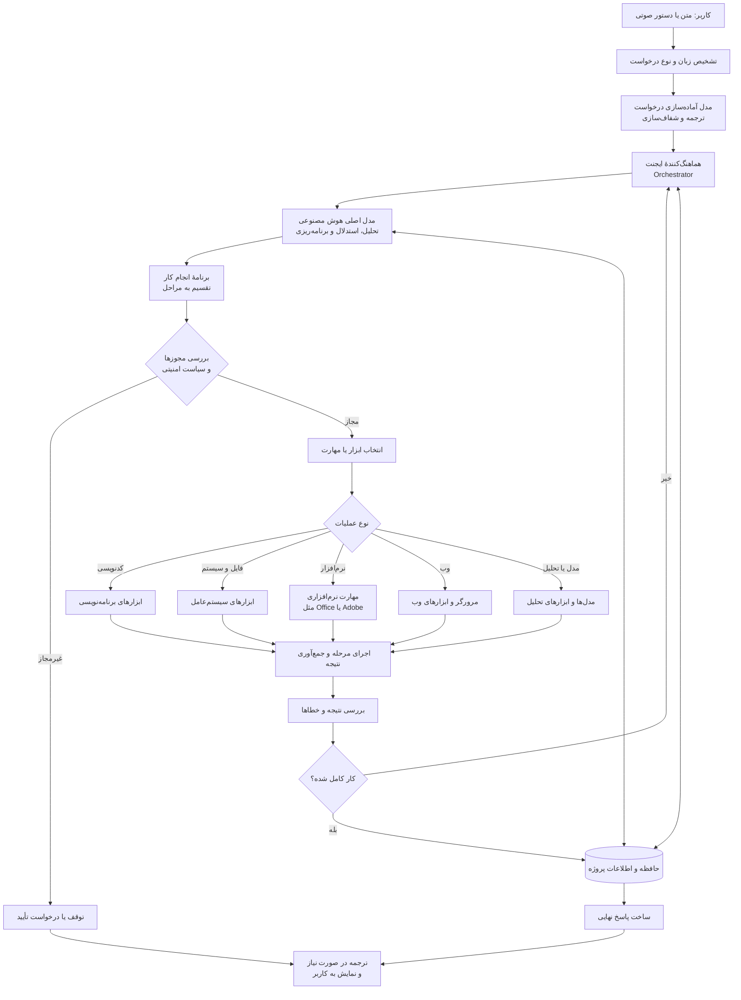
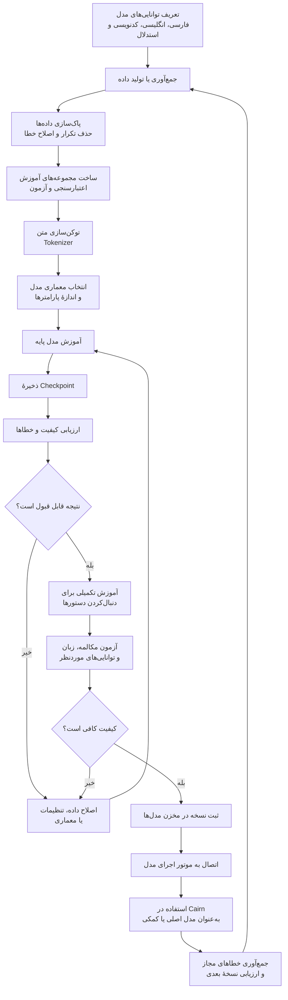

# Cairn reference flows (provided by the project owner, 2026-10-21)

These two flowcharts are the owner's reference for what Cairn must do.
They are the acceptance picture for the runtime (Flow 1) and for the
model-training pathway (Flow 2). Status notes map each part to the
implementation as of v0.1.0; update them as milestones land.

## Flow 1 — Agent execution

Status vs v0.1.0:
- ✅ Language detection + normalization (cairn_models language pipeline, runs
  over the configured model).
- ✅ Orchestrator + planner + step plan (cairn_runtime).
- ✅ Policy/approval gate (sensitive tools, network policy, budgets).
- ✅ Tool execution + result verification + retry loop (orchestrator).
- ✅ Project memory: project files + append-only run journal persist; the
  planner receives project context. Long-term memory beyond the project is
  still basic.
- 🔵 OS/file tools: fs.list/read/write, shell.run, http.get (M5 part 1 done).
  Coding-specific tools (patch/test-run conveniences) build on shell+fs.
- ⬜ Software skills (Office/Adobe-style app skills): skills system, M6.
- ⬜ Full web/browser tool: beyond http.get, M6+.
- ⬜ Voice input: not in v1 scope so far — captured here as an owner
  requirement from this flow; to be scheduled (platform speech input).
- ✅ Final answer passed back through the language pipeline.

## Flow 2 — Model creation & training

Status vs v0.1.0:
- ⬜ This whole flow is roadmap **M9** (training pathway) — not yet built.
- Design anchor: training is heavy compute, so jobs run on the peer with
  the resources (the Windows device via the Tool Host) under the
  symmetric-peer + overflow architecture; the phone can author the model
  project, prepare datasets and monitor the job.
- Honest scope: the pathway implements the full loop of this flowchart
  (define capabilities → data → clean → dataset splits → tokenize →
  architecture/size → train → checkpoint → evaluate → instruction
  fine-tune → registry → serve as a Cairn provider → feedback into the
  next dataset) for small/medium models and fine-tuning on PC-class
  hardware. Training a large foundation model from scratch is bounded by
  the user's hardware, and Cairn must say so in the UI rather than pretend.
- The trained model registers as a model provider (local inference via an
  Ollama-compatible endpoint or the Tool Host) and is then usable as the
  main or auxiliary model of any agent — closing the loop with Flow 1.
